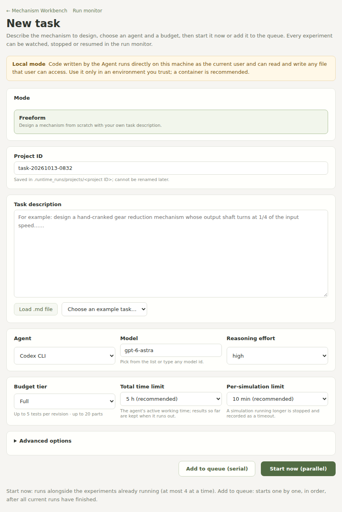

# FunCAD-Harness

[中文版](README.zh-CN.md)

**Coding agents design functional CAD mechanisms, and a physics harness tells
them whether the mechanisms actually work.**

FunCAD-Harness is the harness from the paper *Can It Actually Work? Synthesizing
Functional CAD Mechanisms*. A coding agent (Codex CLI, Claude Code, …) builds a
mechanism as CAD source and STEP geometry from a natural-language task. The
harness turns the original geometry into a PyChrono simulation, an independent
reviewer agent binds the task's functional tests to this particular design, and
the measured results go back to the agent for the next revision — until the
mechanism passes or the budget runs out.

[Project page](https://thegenlab.ai/funcad/) · Paper (arXiv link coming soon) ·
[Citation](#citation)

```
task prompt ─▶ author agent ─▶ CAD source + STEP ─▶ harness prepares geometry
                    ▲                                        │
                    │                                        ▼
         feedback & evidence ◀── PyChrono tests ◀── reviewer binds tests
```

What is in this repository:

- the harness: run loop, budgets, geometry preparation, contact and joint
  modelling, physics runtime and evidence (`simulation_ready_cad_workflow/validation_pipeline`);
- the generic task-template library the agents write tests with (`benchmark_templates/*.py`);
- a web GUI to start runs and watch them live (agent trajectory, CAD history,
  3D viewer, simulation replays);
- agent integrations for **Codex CLI** and **Claude Code**, plus experimental
  Cursor CLI and Kimi CLI.

The FunCADBench benchmark (46 mechanism families, task templates and results)
is not part of this release; *free creation* mode, where you describe a new
mechanism, is fully supported.

## Quick start

There are three ways to run an experiment. All three run the same harness
command line, so you can mix them — for example start a run from your coding
agent and watch it in the GUI.

| Way | How | Good for |
|---|---|---|
| **1. Ask your coding agent** | open Claude Code or Codex in this repository and say *"Read README.md and run a folding stool."* | the quickest start: the agent installs, starts the run and reports back |
| **2. GUI** | `scripts/funcad-gui` (or Docker), then the **New task** page | watching runs live, parallel runs and queues, stop/resume |
| **3. Command line** | `scripts/funcad create --mode free --project … --task …` with parameters | scripts and batches of experiments |

### 1. Ask your coding agent

Clone the repository, open your coding agent (Claude Code, Codex CLI, …) in it
and ask, for example:

> Read README.md and run a folding stool.

(or 「看看 README.md，跑一个折叠凳」). The agent follows
[Running an experiment from a coding agent](#running-an-experiment-from-a-coding-agent):
it installs the environment if needed, starts the run with the command line,
starts the GUI so you can watch, and tells you how the run ended. Your coding
agent only operates the harness; the mechanism itself is designed by the author
and reviewer agents the harness starts (Codex CLI by default), so their CLI must
be logged in.

### Installation

You need an account for one coding agent: [Codex CLI](https://github.com/openai/codex)
(ChatGPT login or `OPENAI_API_KEY`) or [Claude Code](https://docs.anthropic.com/en/docs/claude-code)
(Claude login or `ANTHROPIC_API_KEY`). Then choose **one** of the two
installation paths. Both end in the same GUI.

#### Option A — Docker (recommended)

Docker keeps everything in one image and also isolates the programs the agents
write and run. On Linux or macOS:

```bash
git clone https://github.com/thegenlab/fun-CAD-harness.git
cd fun-CAD-harness
scripts/funcad-docker codex-login      # once; or: scripts/funcad-docker claude-login
scripts/funcad-docker                  # builds the image and starts the GUI
```

Open the `http://127.0.0.1:8765/launch#human=…` link printed in the log.
Runs are saved in `./runs`. Logins are stored in `~/.codex` / `~/.claude` and
shared with the agent CLIs on your host, so an existing host login works too
(except Claude Code on macOS, which keeps its login in the Keychain: use
`claude-login` or `ANTHROPIC_API_KEY`). To use API keys instead, export
`OPENAI_API_KEY` / `ANTHROPIC_API_KEY` before starting. The first build
downloads about 10 GB (mostly PyChrono and its numerical libraries). On Apple
Silicon Macs the x86-64 image runs under Docker Desktop's emulation, which is
slower but works.

On Windows (Docker Desktop, PowerShell): `mkdir runs`, set
`$env:HOME = $env:USERPROFILE`, then `docker compose up --build`.

#### Option B — conda

Linux x86-64 (tested) or Windows x86-64; on macOS use Docker. Requires
[Miniforge](https://conda-forge.org/download/), conda or micromamba,
and the agent CLI on your `PATH` (`npm install -g @openai/codex` and/or
`npm install -g @anthropic-ai/claude-code`). On Linux, Claude Code runs the
author's shell commands in its own sandbox, which needs `bubblewrap` and `socat`
(`sudo apt install bubblewrap socat`).

```bash
git clone https://github.com/thegenlab/fun-CAD-harness.git
cd fun-CAD-harness
scripts/setup_conda.sh      # creates funcad-cad and funcad-chrono, writes .env
scripts/funcad-gui          # starts the GUI on http://127.0.0.1:8765
```

On Windows use `scripts\setup_conda.ps1` and `scripts\funcad-gui.ps1` in
PowerShell. Open the `/launch#human=…` link the GUI prints.

> In conda mode the agents and the programs they write run directly on your
> machine with your user's permissions. Use Docker or a dedicated machine/VM if
> that is not acceptable — see [docs/security.md](docs/security.md).

### 2. Start a run in the GUI



1. On the **New task** page, pick an example (e.g. *cam follower toy*) or write
   your own mechanism description.
2. Choose the agent (Codex CLI or Claude Code), model and reasoning level, the
   budget tier, the total time limit and the per-simulation limit. The
   recommended defaults are the *high* tier with 5 h and 10 min; *light* with
   1 h is a quick first try. Simulation time does not count toward the total
   limit, and a simulation still running at its limit keeps running — up to
   twice the limit, capped at a 30-minute ceiling — before it counts as a
   timeout.
3. Click **Start now (parallel)** to run it alongside anything already running,
   or **Add to queue (serial)** to start it automatically, in order, once the
   current runs have finished. You can come back to the New task page at any
   time to add more experiments.
4. The **Run monitor** page (`/runs`) lists every experiment with how long it
   has been running, its phase, budget use, latest agent activity and result,
   and refreshes itself every few seconds. Each card plays a short animation of
   the newest recorded motion; click it to open the full 3D motion replay. It has **Stop**, **Resume** and
   queue controls; **Open details** leads to the live project view with the
   agent's trajectory, each CAD revision, the 3D model, simulation results and
   replays.

The environment panel on the New task page shows whether the CAD and PyChrono
interpreters and the agent CLIs are ready, with a fix hint for anything missing.
The language switch (中文 / English) is in the page header.

### 3. Command line

The GUI starts the same command you can run yourself. `scripts/funcad` runs it
with the environments from `.env` (Windows: `scripts\funcad.ps1`; Docker:
`scripts/funcad-docker cli …`, with your own task files in `./tasks`):

```bash
scripts/funcad --worker-provider claude_code --reasoning high --tier light \
  create --mode free --construction --project cam_toy --task examples/tasks/cam_follower_toy.md

scripts/funcad resume cam_toy
```

The command runs until the experiment ends. Watch it in the GUI
(`scripts/funcad-gui`), whose Run monitor lists every project, including runs
started from the command line.

## Command line reference

Without `--budget-hours` and `--simulation-timeout` a run gets its tier's
recommended limits (`high`: 5 h total, 10 min per simulation).
`--construction` (what the GUI uses, and the default for the `high` tier) runs
the project under the construction supervisor, which keeps the loop going after
agent mistakes. Projects live in `.runtime_runs/projects/<project>/` (task, workflow state,
agent turns, every revision's design, test runs and evidence).

| Agent | `--worker-provider` | Login | Status |
|---|---|---|---|
| Codex CLI | `codex` (default) | `codex login` or `OPENAI_API_KEY` | used in the paper |
| Claude Code | `claude_code` | `claude` login or `ANTHROPIC_API_KEY` | supported |
| Cursor CLI | `cursor` | `cursor-agent login` | experimental |
| Kimi CLI | `kimi` | Kimi CLI login | experimental |

The independent reviewer defaults to Codex for Codex and Cursor authors and to
the author's own agent otherwise; choose another with `--reviewer-provider` and
`--reviewer-model`. Budgets, tiers, timeouts, models and environment
variables are described in [docs/configuration.md](docs/configuration.md).

## Running an experiment from a coding agent

These steps are for a coding agent (Claude Code, Codex, …) that a user asked to
run an experiment in this repository. You operate the harness; do not design
the mechanism yourself, and never edit files under `.runtime_runs/` or the
harness to change a result.

1. **Environment.** If `.env` is missing, run `scripts/setup_conda.sh`
   (Windows: `scripts\setup_conda.ps1`; it takes 10–20 minutes). If the user
   prefers Docker, use `scripts/funcad-docker cli …` wherever `scripts/funcad …`
   appears below and `scripts/funcad-docker` for the GUI. Check that the
   author agent's CLI is logged in (`codex login status` or
   `claude auth status`); if not, ask the user to log in.
2. **Task.** If the user names an example, use `examples/tasks/<name>.md`
   (`folding_stool`, `cam_follower_toy`, `pulley_hoist`, `screw_jack`).
   Otherwise write the user's description, in English and with measurable
   functional requirements, to `tasks/<project>.md`. A project id is lowercase
   letters, digits and underscores, and must not exist yet in
   `.runtime_runs/projects/` (with Docker: `runs/projects/`).
3. **Start** the run in the background — it runs for hours — with its output in
   a log file:
   ```bash
   mkdir -p .runtime_runs/logs
   nohup scripts/funcad --worker-provider codex --reasoning high --tier high \
     create --mode free --construction --project folding_stool \
     --task examples/tasks/folding_stool.md > .runtime_runs/logs/folding_stool.log 2>&1 &
   ```
   Use the agent, model, reasoning level and budget the user asked for (see the
   [command line reference](#command-line-reference) and
   [docs/configuration.md](docs/configuration.md)); otherwise keep these defaults.
4. **Let the user watch.** Start the GUI in the background
   (`nohup scripts/funcad-gui > .runtime_runs/logs/gui.log 2>&1 &`) and give
   the user the `Run monitor: http://127.0.0.1:8765/runs#human=…` link from
   that log. If a GUI is already running on port 8765, reuse its link.
5. **Check progress** when asked, from
   `.runtime_runs/projects/<project>/workflow.json` (with Docker:
   `runs/projects/<project>/workflow.json`; fields `phase`, `revision`,
   `stop_reason`) and each revision's `runs/rNN/result.json` (`status`,
   per-test results), or from the end of the log. The run has ended when the
   command has exited — after its final motion preview and summary — and the
   last line of its log is a JSON status.
6. **Report** when it has ended: the outcome, how many revisions, which tests
   passed, and the Run monitor link for the motion replays. `scripts/funcad
   resume <project>` continues a stopped run with its remaining budget.

## How a run works

1. **Construction.** The author agent decomposes the prompt into required
   functions, builds the mechanism (any CAD tool; build123d is provided) and
   drafts `task_template.py` with the [template API](benchmark_templates/AUTHORING_API.md).
   It can build, preview, check and simulate drafts with the
   [author tools](simulation_ready_cad_workflow/validation_pipeline/slim_harness/AUTHOR_TOOLS.md)
   during its turn.
2. **Preparation.** The harness imports the original STEP solids, builds
   collision geometry and checks parts, joints and supports. It also tells the
   author about parts that would float in the real assembly — a joint whose pin
   does not reach its hole, a part that touches nothing — as advice that never
   decides a result.
3. **Review and binding.** An independent reviewer agent reviews the template
   and binds its operations and measurements to the actual parts of this design.
4. **Simulation.** PyChrono runs every trial; fixed expressions over measured
   signals decide each functional check.
5. **Feedback.** Results, failure evidence and the remaining budget go back to
   the author, who revises the design, adjusts allowed modelling choices or
   difficulty parameters (recorded, never silently), or finishes.

Physical results always come from the program, never from an agent. When a
revision cannot be prepared, bound or simulated because of what the agents
delivered, the problem goes back to the author as revision feedback. A run ends
when it passes, when its budget is used up (shortly before, the last revision
gets a final evaluation, and the author may choose to deliver what it has), when
an agent login or quota needs you, or when you press Stop. If a run ends
without any playable simulation, the harness exports the poses it has
recorded or lets the final design settle under gravity for a moment, so there
is always a motion to watch; such motions are labelled as previews, not tests.

## Tests

```bash
python scripts/run_tests.py
```

Run with the CAD environment's Python. Tests that need PyChrono run when
`SIMREADY_TEST_CHRONO_PYTHON` points to the physics interpreter and are skipped
otherwise. Tests listed in `simulation_ready_cad_workflow/validation_pipeline/tests/known_failures.txt`
already fail on the development branch this release comes from (mostly outdated
assertions about the budget checkpoint format); they are reported as expected
failures until they are fixed.

## Citation

```bibtex
@article{zhang2026funcad,
  title   = {Can It Actually Work? Synthesizing Functional CAD Mechanisms},
  author  = {Zhang, Wenqian and Huang, Yangyi and Xu, Zigeng and Liu, Weiyang and Liu, Zhen},
  journal = {arXiv preprint arXiv:2610.26861},
  year    = {2026}
}
```

## License

MIT — see [LICENSE](LICENSE). The bundled three.js build in the dashboard keeps
its own MIT notice (`dashboard/static/viewer3d.LICENSE.txt`).
